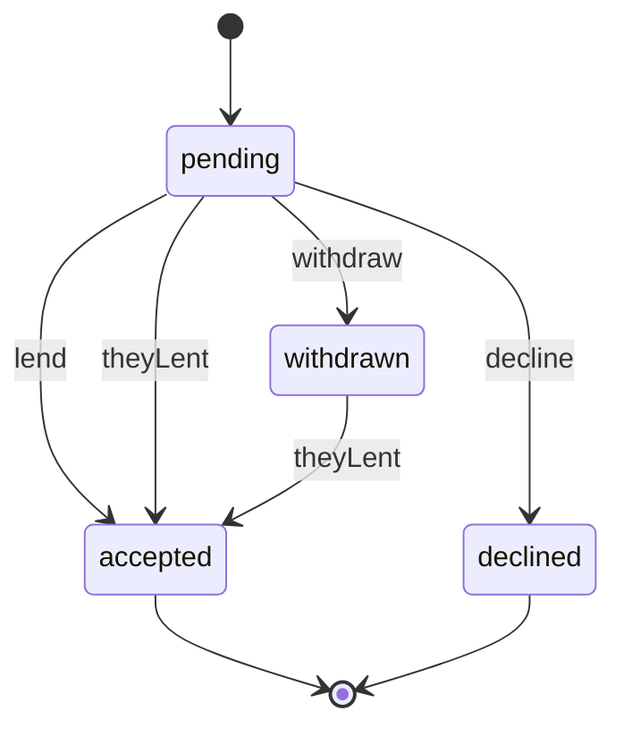
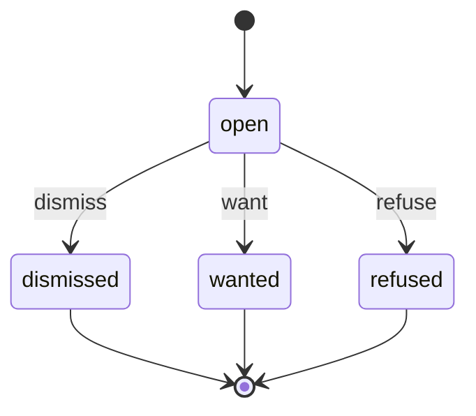
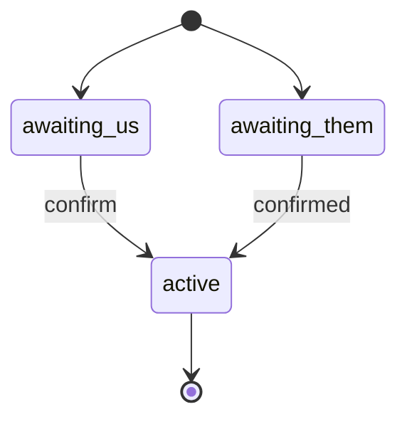

# State machines

Every place in Nalanda where something moves from one state to another, and where each move is decided (ARCH.md
§16 #105). Three kinds:

- **Declared lifecycles**: a status column whose moves are data in [`src/lib/lifecycles.ts`](../src/lib/lifecycles.ts).
  The statements in `src/db/federation.ts` that move one take `to` and `from` from there, and apply the `from` in their
  WHERE, so a repeat or a race changes nothing. The diagrams below are checked against that file by
  `test/lifecycles.spec.ts`. To add a move, add it to the table first; the test refuses a status written by hand in
  `src/db`.
- **Derived states**: no status column, just dates and the presence of a row. They are listed here so nobody adds a
  status column that could disagree with the dates.
- **Browser states**: a page's own machines, each held in one variable in its script and mirrored on the page as an
  attribute. The stylesheet, a screen reader, a test and an agent driving the page all read that same attribute.

## Declared lifecycles

### A request to borrow a book: `borrow_requests.status`

Each side keeps its own row under the same activity id and moves it when the message arrives. "Returned" is not a
status. It is an accepted request whose Borrowed entry came back (`recentOutgoing()`).

| Move | Where it happens |
| --- | --- |
| `withdraw` | `setRequestStatus(…, 'withdraw')`: Withdraw here (routes/borrowing.tsx) or their BorrowWithdraw (federation/borrowing.ts) |
| `decline` | `setRequestStatus(…, 'decline')`: Decline here or their BorrowDecline; `declineOwn()` when they refuse a request outright |
| `lend` | `lendToConnection()`: the loan, its link and the message in one batch |
| `theyLent` | `acceptOwnRequest()`: their BorrowAccept, even after a withdrawal, since the book is already on its way |

### A recommendation: `recommendations.status`

`dismiss` and `want` are this household's answers to theirs (`dismissRecommendation()`, `claimRecommendation()`) and
are never sent back. `refuse` is their refusal of ours (`refuseOwnRecommendation()`). Handled incoming rows are pruned
after `RECOMMENDATIONS_KEPT_DAYS`.

### A connection: `connections.status`

A connection starts waiting on one side or the other, depending on whose invite was redeemed. `confirm` is an admin
here (`activateConnection()`); `confirmed` is their ConnectAccept (`applyConnectionMessage()`). Disconnect and Decline
delete the row, so no status ends a connection.

## Derived states

| What | States | Decided by |
| --- | --- | --- |
| A loan | out · overdue · returned | `returned_on` set → returned; else `due_on` before today (`todayOf(c)`) → overdue (`isOverdue()`) |
| A plain borrow | borrowed · overdue · returned | the same, on `borrows` |
| A read | reading · finished · stopped | `reads.status`, set freely from the item page's Edit (any outcome to any other); `items.status` is the household's summary, written only by `refreshReadState()` (ARCH.md §16 #41) |
| A one-time account link | live · used · expired | the row exists and `expires_at` is ahead; using it deletes it (§16 #97) |
| A device pairing | waiting · approved · claimed · expired | `approved_at`, `expires_at`; claiming deletes the row (§16 #99) |
| A session | live · ended | the row exists, its key and generation match the account's, last used within 30 days (§16 #98) |
| A connection invite | open · used · expired | `used_at`, `expires_at` |
| An outbox message | queued · delivered | `delivered_at`; `attempted_at` paces the retries |

## Browser states

| Machine | States | Held in | Shown as |
| --- | --- | --- | --- |
| A request on its way (`public/app.js`) | idle · pending | htmx's request events; a POST form's submit, until the next page arrives | `aria-busy="true"` on the form or button, and a moving sheen on its button (`app.css`). A plain form refuses a second submit while pending |
| The camera scanner (`public/scanner.js`) | idle · starting · live | `state`, plus an attempt number that Stop and leaving the page end | `data-scanner` on the scan section; Start is `disabled` and `aria-busy` while starting. A camera that answers for an ended attempt is closed at once; frames are read one at a time; the decoder loads once |
| The review list (`public/scan-review.js`) | idle · loading · loading with another load asked for | `loading`, `reloadAsked` | the list and its count. A barcode held during a load is read by one more pass |
| Add all (`public/scan-review.js`) | idle · adding | `addingAll` | the button disabled, and the status line counting |
